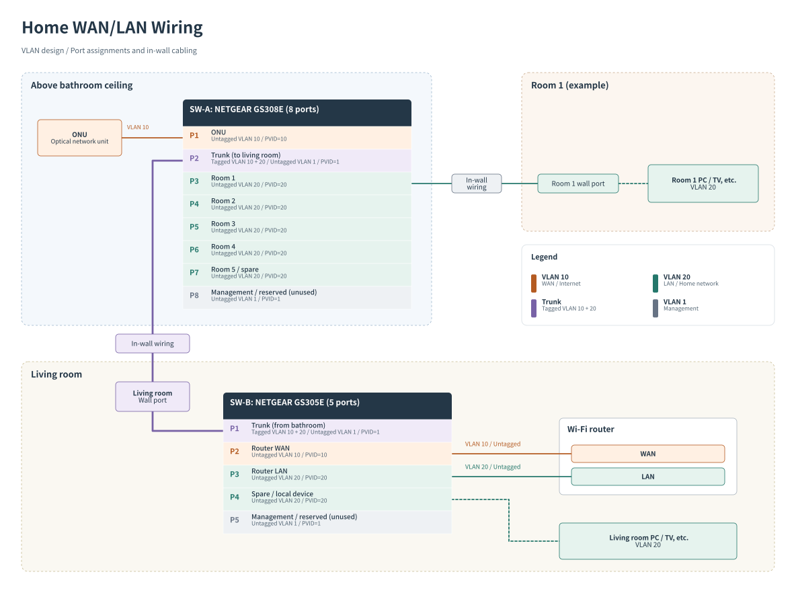

# Home WAN/LAN wiring

This design covers the connections between the ONU, the Wi-Fi router,
and room wall ports through the existing in-wall Ethernet cabling.
It includes the VLANs needed to carry WAN and LAN over a shared link.

Server addressing and network design for homelab workloads are outside
the scope of this document.

## Context

The ONU sits above the bathroom ceiling, where the apartment's in-wall Ethernet
cables also terminate. Placing the Wi-Fi router there would give poor wireless
coverage. The existing Wi-Fi router needs to stay in a room with good coverage
and continue serving as the home's main router.

The goal is to extend this router's LAN to the other rooms through the existing
wall cabling. A single in-wall Ethernet link connects the router's room to the
wiring above the bathroom.

## Requirements

- Keep the existing Wi-Fi router in its current location and retain its routing and wireless functions.
- Connect wired devices in other rooms to the same home LAN served by that router.
- Reuse the existing wall cabling, including the single link to the router's room.
- Keep the router's WAN connection and home LAN separate while sharing that link.

## Concept

Two logical connections are needed across the link: the WAN connection from the
ONU to the router, and a LAN connection from the router back to the room cabling
above the bathroom.

A VLAN-capable switch at each end carries these connections as separate VLANs
over one tagged trunk. The switch above the bathroom (SW-A) connects the ONU and
the room cables. The switch beside the router (SW-B) connects through the room's
wall jack and provides separate connections to the router's WAN and LAN ports.

The switches present untagged Ethernet to the ONU, router, and client devices, so
the router does not need to handle VLAN tags. It continues to provide routing
and Wi-Fi, while wired devices in other rooms join its LAN through SW-A.

## Topology

The diagram shows the living room arrangement, including switch models, cabling,
and port and VLAN assignments.

## Design considerations

WAN and LAN traffic share the trunk's capacity. If the trunk fails, the router
loses both its connection to the ONU and its LAN connection to the other rooms.

## Inspiration

This design was inspired by [M3 Tech Blog's article on using VLANs at home](https://www.m3tech.blog/entry/vlan-at-home)
(Japanese, 2018-12-29). The shared concept is to carry WAN and LAN traffic over one
cable using VLANs, allowing the router to be placed in a room.
